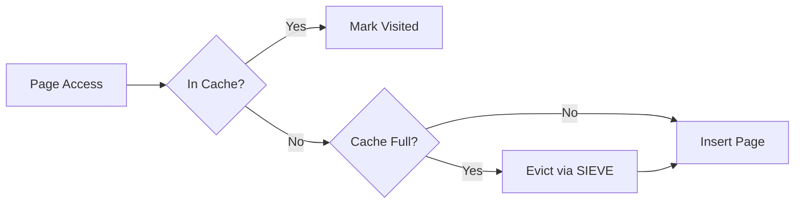

# Engine Cache Layers

RedDB has separate caches for physical pages, query plans, entities, and full
query results. The full result cache is an internal adapter over the same
native Blob Cache L1/L2 engine exposed to applications; the page cache remains
a separate storage acceleration structure.

## Page Cache (SIEVE)

RedDB uses the SIEVE eviction algorithm for its page cache, providing better hit rates than traditional LRU for database workloads.

## What is SIEVE?

SIEVE is a cache eviction algorithm that:

- Tracks access frequency with minimal overhead
- Outperforms LRU on skewed workloads (common in databases)
- Uses O(1) operations for both lookup and eviction
- Adapts to changing access patterns

## How It Works

1. **On access**: Mark the page as recently used
2. **On eviction**: Scan from a hand pointer, evicting the first page not recently used
3. **On insert**: If cache is full, evict first, then insert



## Benefits for RedDB

| Property | Advantage |
|:---------|:---------|
| Scan resistance | Range scans don't flush hot pages |
| Frequency awareness | Frequently accessed pages stay cached |
| Low overhead | No lock contention on reads |
| Adaptive | Adjusts to workload changes |

## Cache Statistics

Cache performance is visible in the runtime stats:

```bash
curl -s http://127.0.0.1:5000/stats
```

## Relation to Page-Based Storage

The SIEVE cache sits between the query engine and the pager:

```
Query Engine --> SIEVE Cache --> Pager --> Disk
                    |
                    +-- Cache Hit: return page from memory
                    +-- Cache Miss: read from pager, cache result
```

---

## Result Cache

Before entering the query executor, RedDB checks an internal **query result
cache** for eligible `SELECT` results. This is not a second cache engine: the
adapter stores entries in Blob Cache under the reserved
`runtime.result_cache` namespace and adds query identity, authorization scope,
dependency tracking, and durable data-epoch validation. Application cache APIs
cannot read, write, or flush this namespace.

HTTP, gRPC, RedWire, and PostgreSQL-wire queries converge on this same runtime
statement path, so the result-cache policy does not depend on the protocol.
Keys include the SQL text plus the current tenant and auth identity, so scoped
callers do not share cached rows.

| Property | Value |
|:---------|:------|
| TTL | 30 seconds |
| Max entries | 1 000 |
| Eviction | Oldest entry removed when full |
| Scope | SELECT queries only |
| L1 | process-local Blob Cache plus decoded runtime entries |
| Persistent L2 | hidden `red.cache.blob_l2` collection in the same `.rdb` |

### How It Works

1. The common runtime statement path derives the cache key and data epoch.
2. Before parsing, it checks `runtime.result_cache` through Blob Cache.
3. On a valid hit, it returns the decoded result immediately (no parse, plan, or scan).
4. On a miss, the query executes normally and the result is stored with its collection dependencies.
5. Writes invalidate affected result-cache entries. The result cache
   preserves unrelated results when every L2 entry is tracked; otherwise it
   flushes the namespace to protect untracked durable entries.

Eligible results can be rehydrated from L2 after restart until their TTL expires. Following
invalidation by a table write, new results are kept only in memory while
matching writes continue. A background worker promotes the result to L2 with its remaining TTL
after at least one second without a matching invalidation.
A restart before promotion recomputes the result. Persisted results carry a
data epoch recorded with the data's WAL commit; a result from an older epoch
is recomputed after recovery. This can also discard an unrelated result after
a write. Within one process, tracked table and join results can remain usable
across unrelated writes when the bounded publication history proves that none
of their dependencies changed. A missing history or an uncertain publication
causes a cache miss. Statements rejected by the normal safety gate
still do not persist: volatile builtins, active-transaction reads,
oversized result sets, system-collection and vault results, and pre-serialized fast paths are
recomputed instead.

Before persisting results, RedDB fences the database format so binaries that do
not maintain the data epoch cannot open it for writing. The first activation may
therefore require a durable checkpoint.

```
SELECT * FROM users WHERE active = true
  1st call: miss → parse + plan + execute + cache
  2nd call: hit  → return the cached result
  After INSERT: miss → dependency changed, so re-execute
```

### Regression Coverage

Unit tests assert that a hot hit returns before the parser, planner, and
executor; that disabling the cache executes every read; and that a write to a
dependency forces one recomputation before the next hit. The checked-in
Criterion benchmark compares cache-off and verified hot-hit paths without
using wall-clock thresholds as correctness assertions:

```bash
cargo test -p reddb-io-server --lib result_cache_execution_tests
cargo bench -p reddb-io-server --bench result_cache_bench
```

### Invalidation

The result cache is cleared or narrowed by dependency on write paths:
- SQL DML: `INSERT`, `UPDATE`, `DELETE`
- REST API: entity create, patch, delete
- Retention policy sweep
- Any operation that calls the runtime cache invalidation hooks

The result cache flushes the namespace when a tracked result depends on
the written table, or when L2 may contain untracked results (such as after a
restart or tracking eviction). It skips the flush for unrelated writes when
all entries are tracked.

---

## Query Plan Cache

Parsed query plans are cached to avoid re-parsing and re-planning identical SQL strings.

| Property | Value |
|:---------|:------|
| Capacity | 1 000 plans |
| TTL | 1 hour |
| Eviction | LRU (least recently used) |

### How It Works

1. Before calling `parse_multi(query)`, the runtime checks the plan cache
2. On cache hit, the cached `QueryExpr` is used directly (skips lexer + parser + planner)
3. On cache miss, the query is parsed normally and the result is stored

The plan cache saves ~100us per query for repeated SQL patterns. It is especially effective for application code that issues the same parameterized queries.

### Cache Layers Summary

```
┌──────────────────────────────────────────────────────┐
│ Result Cache adapter (runtime.result_cache)           │
│   Hit → return full result before parse/plan/execute  │
│   Storage → native Blob Cache L1/L2                   │
├──────────────────────────────────────────────────────┤
│ Plan Cache     (1h TTL, 1K entries, LRU)              │
│   Hit → skip parse/plan, go straight to execution     │
├──────────────────────────────────────────────────────┤
│ SIEVE Page Cache (10K pages, ~40MB)                   │
│   Hit → return page from memory, no disk I/O          │
├──────────────────────────────────────────────────────┤
│ Entity Cache   (10K entities, LRU)                    │
│   Hit → skip cross-collection scan for get_any(id)    │
└──────────────────────────────────────────────────────┘
```

## Blob Cache

The native **Blob Cache** is the shared exact-key cache engine. It provides a
byte-bounded, sharded process-local L1 and a durable L2 inside the database
file, plus TTL, fast existence checks, and invalidation by key, prefix, tag,
dependency, or namespace generation. The result cache is its first internal
caller; remote applications use tenant-partitioned application namespaces.

Applications can access the native module through the HTTP data plane and
`db.cache.*` in the remote JavaScript client using HTTP. See
[Remote Blob Cache](/api/cache.md) for supported policies, tenant isolation,
limits and node-local invalidation behavior, and
[ADR 0006](/adr/0006-tiered-blob-cache.md) for the architecture.
