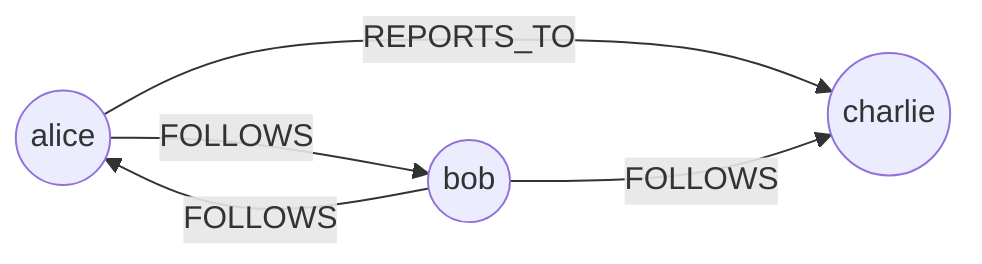

# Node & Edge Model

RedDB's graph engine uses a labeled property graph model where nodes and edges carry labels, types, and arbitrary properties.

## Nodes

A node represents an entity in the graph:

| Field | Required | Description |
|:------|:---------|:------------|
| `label` | Yes | Unique identifier within the collection (e.g., `"alice"`, `"web-01"`) |
| `node_type` | No | One concrete type (e.g., `"person"`, `"host"`, `"service"`); defaults to the label |
| `properties` | No | Arbitrary key-value properties |
| `metadata` | No | Operational metadata |

```bash
curl -X POST http://127.0.0.1:5000/collections/social/nodes \
  -H 'content-type: application/json' \
  -d '{
    "label": "alice",
    "node_type": "person",
    "properties": {
      "name": "Alice Johnson",
      "department": "engineering"
    }
  }'
```

## Edges

An edge represents a directed relationship between two nodes:

| Field | Required | Description |
|:------|:---------|:------------|
| `label` | Yes | Relationship type (e.g., `"FOLLOWS"`, `"REPORTS_TO"`) |
| `from_rid` | Yes | Source node RedDB ID |
| `to_rid` | Yes | Target node RedDB ID |
| `weight` | No | Numeric weight (default `1.0`) |
| `properties` | No | Arbitrary key-value properties |
| `metadata` | No | Operational metadata |

```bash
curl -X POST http://127.0.0.1:5000/collections/social/edges \
  -H 'content-type: application/json' \
  -d '{
    "label": "FOLLOWS",
    "from_rid": 102,
    "to_rid": 103,
    "weight": 1.0,
    "properties": {"since": "2024-01-01"}
  }'
```

## Optional graph contract

A Graph collection can opt into a contract defining vertex types, edge types,
required properties and endpoint types. Each vertex has one `node_type` string;
multiple simultaneous types and type inheritance are not supported. Without a
contract, existing schemaless behavior remains available.

Install or replace a contract with `PUT /v1/collections/social/graph/contract`:

```json
{
  "vertex_types": {
    "Person": {
      "properties": {"age": {"data_type": "INT", "required": true}}
    },
    "Company": {"properties": {}}
  },
  "edge_types": {
    "WORKS_AT": {
      "from_type": "Person",
      "to_type": "Company",
      "properties": {}
    }
  }
}
```

`GET` on the same path returns the contract, or `null`. Sending JSON `null` with
`PUT` disables it. These operations also have `/collections/...` aliases. Native
Rust callers use `RedDBRuntime::graph_contract` and `set_graph_contract` with the
types exported from `reddb::catalog`.

Property types use RedDB's declared type names. Required properties reject
missing values and `NULL`; declared values must already have the required type.
Undeclared properties remain allowed. Vertex types and edge labels must be
declared. Both edge endpoints must exist in the same collection and match the
declared types. Cross-collection projections remain available on graphs without
this contract.

Enabling a contract validates existing data on every live VCS branch. Contract
changes require active transactions to finish and apply to the collection across
branches. Inserts, updates, deletes, transaction commits, merges and changes of
VCS data view validate the resulting graph. Delete referencing edges before deleting
a vertex, or delete both in one statement. Historical reads retain their original
data; installing an invalid historical data view through hard reset or merge is
rejected. Soft/mixed reset only moves commit references and retains working data.

Validation scans the projected graph and uses query memory admission. It is an
opt-in integrity check with a cost proportional to the graph size. The contract
persists with the collection; enabling it upgrades storage to V14, which older
readers must reject.

## Graph Storage

Nodes and edges are stored as entities in the same collection system as rows and vectors. They participate in:

- Universal queries (`FROM ANY`)
- Collection scans
- Metadata filtering
- Bulk operations

## Adjacency

The graph engine maintains adjacency lists for efficient traversal:



## Multi-Collection Graphs

Graph entities from different collections can be queried together using graph projections. A projection defines which collections, node types, and edge labels to include.

## RedDB ID Referencing

Edges reference nodes by RedDB ID (`rid`), which is a globally unique u64.
Use `from_rid` for the source endpoint and `to_rid` for the target endpoint.
This means edges can connect nodes across collections when using projections.
